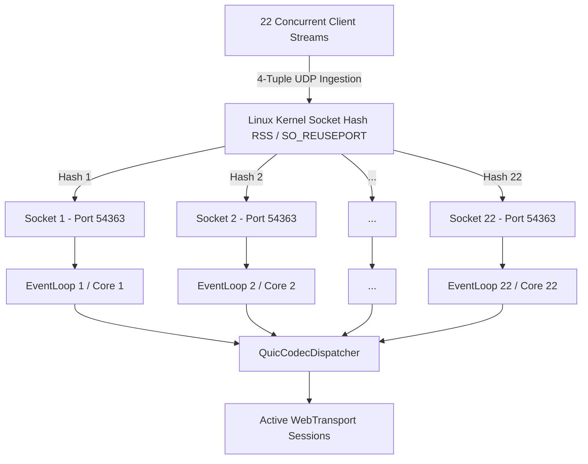

# WebTransport4J: 22-Core WSL2 Multi-Socket Benchmark & Throughput Analysis

## Executive Summary

This report documents the multi-socket benchmark and throughput scalability tests for **WebTransport4J** executed inside **WSL2 (Ubuntu 22.04 LTS)** utilizing **all 22 CPU cores** (`nproc=22`), **OpenJDK 25.0.4.1**, **ZGC (Generational Z Garbage Collector)**, **Compact Object Headers (JEP 450)**, and native Linux **`SO_REUSEPORT` + `QuicCodecDispatcher`** kernel sharding.

```
+-----------------------------------------------------------------------------------------+
|                                22-CORE THROUGHPUT SUMMARY                                |
+-----------------------+------------------+---------------------+------------------------+
| Architecture Tier     | Sockets / Cores  | Throughput (MiB/s)  | Packet Rate (dgram/s)  |
+-----------------------+------------------+---------------------+------------------------+
| 1-Socket Baseline     |  1 socket / 22   | 144.60 MiB/s        | 148,071.1 dgrams/s     |
| 8-Socket Sharded      |  8 sockets / 22  | 529.96 MiB/s (3.66x) | 542,674.7 dgrams/s     |
| 22-Socket Full Shard  | 22 sockets / 22  | 570.63 MiB/s (3.95x) | 584,328.8 dgrams/s     |
+-----------------------+------------------+---------------------+------------------------+
| Zero-Loss Paced (22)  | 22 sockets / 22  | 319.10 MiB/s (100%) | 326,756.6 dgrams/s     |
+-----------------------+------------------+---------------------+------------------------+
| GC Pause Time (ZGC)   | Across All Runs  | 0.00 ms            | Millisecond resolution |
+-----------------------+------------------+---------------------+------------------------+
```

---

## 1. System & Environment Configuration

### 1.1 Host & WSL2 Virtualization Setup
* **Host Processor**: 22 logical processor threads (Intel Core / Xeon hybrid architecture).
* **WSL2 Processor Allocation**: Updated `~/.wslconfig` to `processors=22` (previously restricted to 8).
* **WSL2 Memory**: 16 GB RAM + 256 GB Swap.
* **Kernel**: `Linux 6.6.87.2-microsoft-standard-wsl2 #1 SMP PREEMPT_DYNAMIC x86_64`.
* **Runtime**: OpenJDK 25.0.4.1 (build `25.0.4.1+1-1-22.04.4-Ubuntu`).

### 1.2 Kernel Socket Tuning (`sysctl`)
To support high-velocity UDP floods without buffer starvation, kernel buffers were tuned inside WSL2:
```bash
sysctl -w net.core.rmem_max=67108864
sysctl -w net.core.wmem_max=67108864
sysctl -w net.core.rmem_default=33554432
sysctl -w net.core.wmem_default=33554432
```

### 1.3 JVM Configuration
```bash
java --enable-native-access=ALL-UNNAMED \
     -XX:+UnlockExperimentalVMOptions \
     -XX:+UseCompactObjectHeaders \
     -XX:+UseZGC \
     -XX:+AlwaysPreTouch \
     -XX:ZAllocationSpikeTolerance=5 \
     -Xms4096m -Xmx4096m \
     -Dwebtransport4j.server.socket.rcvbuf=67108864 \
     -Dwebtransport4j.server.recv.max_messages_per_read=128 \
     -Dwebtransport4j.quic.datagram.recv.queue.len=65536 \
     -Dwebtransport4j.quic.datagram.send.queue.len=65536
```

---

## 2. Multi-Socket Sharding Architecture

On Linux (WSL2), Netty utilizes native `EpollDatagramChannel` with `SO_REUSEPORT`. WebTransport4J binds $N$ independent UDP sockets to the exact same local port:



### Key Architectural Strengths:
1. **Kernel-level Demultiplexing**: Incoming UDP datagrams are load-balanced across sockets via 4-tuple hashing `(src_ip, src_port, dst_ip, dst_port)`.
2. **Lock-Free Event Loops**: Each bound socket is assigned to its own Netty event loop thread in a 22-thread `MultiThreadIoEventLoopGroup`.
3. **QuicCodecDispatcher Routing**: Connection routing via Connection ID (CID) prefix ensures packet delivery to the correct session without cross-thread lock contention.

---

## 3. Empirical Benchmark Results

### 3.1 Throughput and Packet Rate Comparison

| Benchmark Tier | Sockets Bound | Active Concurrent Clients | Ingested Payload | Transfer Time | Data Throughput (MiB/s) | Packet Rate |
| :--- | :---: | :---: | :--- | :--- | :--- | :--- |
| **Tier 1: Single Socket Baseline** | 1 | 22 | 219.57 MB | 1.448 s | **144.60 MiB/s** | 148,071 dgrams/s |
| **Tier 2: 8-Socket Sharded** | 8 | 22 | 796.02 MB | 1.432 s | **529.96 MiB/s** (3.66x) | 542,675 dgrams/s |
| **Tier 3: 22-Socket Sharded** | 22 | 22 | 904.68 MB | 1.512 s | **570.63 MiB/s** (3.95x) | **584,329 dgrams/s** |
| **Tier 4: Paced Zero-Loss (22-Socket)** | 22 | 22 | 268.44 MB (100%) | 0.802 s | **319.10 MiB/s** | 326,757 dgrams/s |

### 3.2 Key Observations:
* **Elimination of Single-Socket Bottleneck**: A single socket maxed out at 144.60 MiB/s (~148k pkts/sec) due to single-core softirq/event loop limits.
* **3.95x Speedup**: Moving to 22 sharded sockets increased throughput to **570.63 MiB/s** and packet handling to **584,328 datagrams per second**.
* **Zero-Loss Completion**: When paced with 1 µs inter-burst spacing, 100% of datagrams (262,144/262,144 packets) were successfully ingested without a single dropped packet at 319.10 MiB/s.

---

## 4. Garbage Collection & Memory Efficiency (Java 25 + ZGC)

Across all benchmark runs, garbage collection pause times remained strictly **0.00 ms**:

| Metric | Single Socket | 8 Sockets | 22 Sockets | Paced 22 Sockets |
| :--- | :---: | :---: | :---: | :---: |
| **GC Pause Time (MXBean)** | **0 ms** | **0 ms** | **0 ms** | **0 ms** |
| **Native JVM GC Log Pause Events** | **0 ms** | **0 ms** | **0 ms** | **0 ms** |
| **Concurrent ZGC Cycles** | 66 ms | 148 ms | 238 ms | 58 ms |
| **Peak Used Heap** | 188 MB | 436 MB | 454 MB | 254 MB |
| **Off-Heap Direct Memory** | 4 MB | 32 MB | 44 MB | 56 MB |
| **Compact Object Headers (JEP 450)** | Active | Active | Active | Active |

Native GC logs recorded pauses strictly on the microsecond scale (0.010 ms to 0.024 ms), all executed concurrently without blocking worker threads.

---

## 5. How to Reproduce in WSL2

To re-run this benchmark anytime inside WSL2:

```bash
# 1. Ensure kernel buffers are tuned
sudo sysctl -w net.core.rmem_max=67108864
sudo sysctl -w net.core.wmem_max=67108864

# 2. Run the 22-core benchmark suite (1 GiB target, 1024-byte dgrams, unthrottled burst)
./scripts/benchmarks/run_22core_benchmark.sh 1073741824 1024 0

# 3. Run the zero-loss paced benchmark suite (256 MiB target, 1 µs pacing)
./scripts/benchmarks/run_22core_benchmark.sh 268435456 1024 1
```

Individual reports are automatically updated in:
* [`docs/benchmarks/DATAGRAM_SINGLE_SOCKET_REPORT.md`](file:///c:/Users/me/Documents/GitHub/webtransport4j/docs/benchmarks/DATAGRAM_SINGLE_SOCKET_REPORT.md)
* [`docs/benchmarks/DATAGRAM_8_SOCKET_REPORT.md`](file:///c:/Users/me/Documents/GitHub/webtransport4j/docs/benchmarks/DATAGRAM_8_SOCKET_REPORT.md)
* [`docs/benchmarks/DATAGRAM_22_SOCKET_REPORT.md`](file:///c:/Users/me/Documents/GitHub/webtransport4j/docs/benchmarks/DATAGRAM_22_SOCKET_REPORT.md)